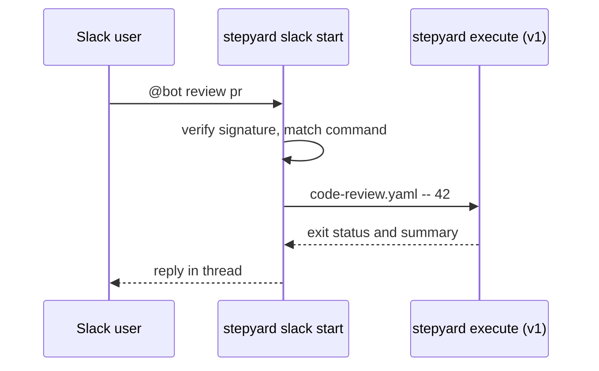

# Slack bot



Start Stepyard workflows from Slack. Mention the bot in a channel:

```
@YourBot review pr #42
@YourBot fix issue https://github.com/org/repo/issues/10
@YourBot security audit myproject
@YourBot generate docs myproject
```

The bot runs `stepyard execute <workflow> --engine v1 [--repo owner/repo] -- <target>`
on the machine where it runs, and posts the result in the thread. It pins the
v1 engine because it uses `--repo` and dispatches `fix-ci.yaml`, which the v2
engine does not support yet.

## 1. Create a Slack app

1. Go to <https://api.slack.com/apps> → **Create New App** → **From scratch**.
2. Name it (for example "Stepyard") and select your workspace.

## 2. Set permissions

Go to **OAuth & Permissions** → **Bot Token Scopes** and add:

| Scope | Purpose |
|-------|---------|
| `app_mentions:read` | Detect `@YourBot` mentions |
| `chat:write` | Post replies |
| `channels:history` | Read channel messages |
| `channels:read` | List channels |

Click **Install to Workspace** and copy the **Bot User OAuth Token** (`xoxb-...`).

## 3. Subscribe to events

Go to **Event Subscriptions** and turn it **on**. Under **Subscribe to bot
events**, add `app_mention`.

The Request URL must be public. For development, use [ngrok](https://ngrok.com):

```bash
ngrok http 9000
```

Set the Request URL to `https://<your-ngrok-domain>/slack/events`, wait for
**Verified**, and click **Save Changes**.

## 4. Copy the signing secret

Go to **Basic Information** → **App Credentials** and copy the **Signing Secret**.

## 5. Install and configure Stepyard

```bash
cargo install --locked --git https://github.com/allanbrunobr/stepyard --features slack
stepyard setup    # asks for the Slack token and signing secret
```

`stepyard setup` writes `~/.stepyard/config.toml`:

```toml
[core]
anthropic_api_key = "sk-ant-..."
workflows_dir = "./workflows"

[slack]
bot_token = "xoxb-..."
signing_secret = "..."
port = 9000
```

Environment variables override the file:

| Variable | Meaning |
|----------|---------|
| `SLACK_BOT_TOKEN` | Bot User OAuth Token |
| `SLACK_SIGNING_SECRET` | Signing secret used to verify Slack requests |
| `STEPYARD_WORKFLOWS_DIR` | Directory with workflow files |

If no workflow directory is set, the bot uses `./workflows` when it exists.
Otherwise it writes the workflows embedded in the binary to
`~/.stepyard/workflows/` on first start and uses them.

## 6. Start the bot

```bash
stepyard slack start            # listens on 0.0.0.0:9000
stepyard slack start --port 8080
```

## 7. Invite the bot

In the Slack channel, run `/invite @YourBot`, then mention it.

## Supported commands

| Message | Workflow |
|---------|----------|
| `@bot fix issue #10` or `@bot fix issue <url>` | `fix-issue.yaml` |
| `@bot review pr #42` or `@bot review pr <url>` | `code-review.yaml` |
| `@bot security audit <target>` | `security-audit.yaml` |
| `@bot generate docs <target>` | `generate-docs.yaml` |
| `@bot fix ci <pr-url>` | `fix-ci.yaml` |

When the message contains a GitHub URL, the bot passes `--repo owner/repo` to
the workflow.

## Security notes

- The bot verifies every request with the signing secret. Do not share it.
- Workflows run with the environment of the bot process, including your API
  keys and `gh` credentials. Run the bot on a machine and account that you
  trust, and limit who can mention it.
